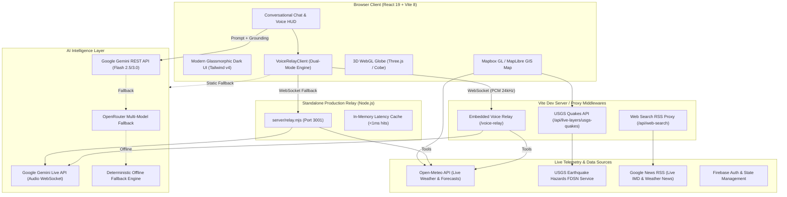

# 🌤️ WeatherGPT

> **Next-Generation Conversational AI for Weather Forecasting, Early Hazard Alerts & Regional Climate Intelligence**  
> Operational meteorological intelligence platform aligned with Ministry of Earth Sciences (MoES) and India Meteorological Department (IMD) standards.

[](https://react.dev/)
[](https://www.typescriptlang.org/)
[](https://vitejs.dev/)
[](https://tailwindcss.com/)
[](https://ai.google.dev/)
[](https://www.mapbox.com/)
[](LICENSE)

---

## 📑 Table of Contents

- [📌 Overview & Mission](#-overview--mission)
- [🏗️ System Architecture](#️-system-architecture)
- [🌟 Key Capabilities](#-key-capabilities)
  - [1. Real-Time Bidirectional Voice AI (Gemini Live)](#1-real-time-bidirectional-voice-ai-gemini-live)
  - [2. Multilingual Conversational AI Assistant](#2-multilingual-conversational-ai-assistant)
  - [3. Interactive Geospatial Weather & Disaster GIS Map](#3-interactive-geospatial-weather--disaster-gis-map)
  - [4. Severe Hazard Early Warning System](#4-severe-hazard-early-warning-system)
  - [5. Agro-Climate & Farm Advisory Engine](#5-agro-climate--farm-advisory-engine)
  - [6. Macro-Climate Analytics & Monsoon Tracking](#6-macro-climate-analytics--monsoon-tracking)
  - [7. 3D WebGL Globe & Planetary Telemetry](#7-3d-webgl-globe--planetary-telemetry)
  - [8. System Preferences & Dynamic Customization](#8-system-preferences--dynamic-customization)
  - [9. Authentication & User Profiles](#9-authentication--user-profiles)
- [🗣️ Supported Languages (12 Indic Languages + Hinglish)](#️-supported-languages-12-indic-languages--hinglish)
- [🛠️ Technology Stack](#️-technology-stack)
- [🔌 Meteorological Tool & Telemetry APIs](#-meteorological-tool--telemetry-apis)
- [⚙️ Environment Configuration](#️-environment-configuration)
- [🚀 Quick Start Guide](#-quick-start-guide)
- [🧪 Verification & Benchmarking Suite](#-verification--benchmarking-suite)
- [📁 Project Directory Structure](#-project-directory-structure)
- [🚨 Safety Guardrails & Emergency Helplines](#-safety-guardrails--emergency-helplines)
- [📄 License](#-license)

---

## 📌 Overview & Mission

**WeatherGPT** is an operational AI meteorological intelligence platform designed to deliver authoritative, hyper-localized weather forecasts, severe hazard bulletins, agro-climate advisories, and interactive geospatial telemetry across India and global territories.

By combining real-time numerical models (GFS, ECMWF, IMD telemetry, INSAT satellite layers) with advanced conversational AI, WeatherGPT empowers citizens, farmers, emergency responders, and regional authorities with instant, actionable climate intelligence in both English and major Indic languages (Hindi, Hinglish, Marathi, Bengali, Tamil, Telugu, Gujarati, and more).

### Core Objectives
1. **Zero-Latency Spoken Access**: Enable hands-free voice interactions for rural farmers and field emergency workers using Google's bidirectional Gemini Live Audio model.
2. **Authoritative Grounding**: Eliminate hallucinations by injecting real-time Open-Meteo observations, live USGS seismic reports, and Google News RSS weather updates into model context.
3. **Severe Weather Life Safety**: Provide immediate, protocol-adherent hazard early warnings (Red/Orange/Yellow bulletins) with actionable mitigation checklists and emergency helpline directives.
4. **Subcontinent Regional Fluency**: Provide native script and transliterated (Hinglish) support across 12 official regional languages.

---

## 🏗️ System Architecture

The following diagram illustrates the end-to-end architecture connecting the client interface, development middleware, backend WebSocket voice relay, and external meteorological/AI data providers:



---

## 🌟 Key Capabilities

### 🎙️ 1. Real-Time Bidirectional Voice AI (Gemini Live)
- **Native Speech-to-Speech**: Full-duplex voice interaction with sub-second latency powered by Google's bidirectional `models/gemini-2.5-flash-native-audio-latest` audio model.
- **Mid-Conversation Autonomous Tool Execution**: The live voice agent autonomously calls WeatherGPT meteorological tools (`get_live_weather`, `get_disaster_alerts`, `get_weather_alerts`, `get_earthquakes`, `get_regional_climate_stats`, `get_agro_climate_advisory`) mid-sentence to speak verified numbers.
- **ChatGPT / Claude Style Voice HUD**: Pulsing audio-reactive visualizer orb, listening/thinking/speaking state indicators, and tap-to-interrupt barge-in capability.
- **Dual-Mode Voice Architecture**:
  1. *Relay Mode*: High-performance 24kHz bi-directional PCM streaming over WebSockets.
  2. *Browser Voice Fallback*: Web Speech API speech recognition + conversational engine + SpeechSynthesis for zero-configuration deployments on static CDNs (e.g. Firebase Hosting, Vercel).
- **Secure Server-Side Credential Handling**: `GEMINI_API_KEY` is held strictly on the backend relay (`server/relay.mjs` or embedded Vite middleware), never exposed to client bundles.
- **Instant Spoken Delivery Mandate**: Prompts are optimized to deliver core weather observations in the first 3-5 words without conversational filler or Markdown artifacts.

### 🤖 2. Multilingual Conversational AI Assistant
- **Bilingual & Hinglish Native Fluency**: Natural comprehension of English, Hindi, Hinglish (*"aaj Mumbai me baarish hogi kya"*), Marathi, Bengali, Tamil, Telugu, and 6 other Indic languages.
- **Automated Unicode Script Detection**: Identifies regional scripts (Devanagari, Bengali, Gurmukhi, Gujarati, Odia, Tamil, Telugu, Kannada, Malayalam) and automatically responds in that language.
- **Meteorological Domain Guardrails**: MoES safety filters ensure 100% focused, authoritative weather, climate, and agro-met outputs while politely redirecting off-topic inquiries.
- **Multi-Engine Intelligence with Automatic Failover**:
  1. *Primary*: Google Gemini API (`gemini-flash-latest`, `gemini-3-flash-preview`, `gemini-3.1-flash-lite`).
  2. *Secondary*: OpenRouter API (`minimax/minimax-m2.7`, `google/gemma-4-31b-it`).
  3. *Resilience Layer*: Built-in offline deterministic simulation engine in all 12 languages.
- **Real-Time Temporal Grounding**: Injects real-time IST timestamps, current day of week, and active year to guarantee models never output stale dates.
- **Deep-Thinking Trace Extraction**: Automatically extracts and displays `<think>` tags and reasoning chains in an expandable accordion view.
- **Interactive Markdown & Speech Synthesis**: Renders clean Markdown tables and includes a one-click Web Speech API read-aloud button on every message.

### 🗺️ 3. Interactive Geospatial Weather & Disaster GIS Map
- **High-Performance Vector Rendering**: Powered by Mapbox GL JS and MapLibre GL with dark, satellite, terrain, and navigation styles.
- **6 Specialized Live Geological & Meteorological GIS Overlays**:
  1. 🌧️ **Rainfall Radar Layer**: Colorized precipitation intensity radar sweep.
  2. 🌀 **Cyclone Track & Forecast Cones**: Multi-category storm tracks with wind speed radii and cone projections.
  3. 🌊 **Flood Inundation Zones**: High-risk river basins and drainage overflow monitoring polygons.
  4. ⚠️ **IMD Severe Warning Polygons**: Official Red, Orange, and Yellow warning zones.
  5. 🌡️ **Temperature Heatmap**: Dynamic isotherm gradient visualization across meteorological subdivisions.
  6. 🌋 **USGS Live Earthquakes Layer**: Real-time seismic tremor markers scaled by Richter magnitude and depth.
- **Disaster Hotspot Jump Navigation**: Instant one-click camera fly-to for high-vulnerability corridors (Joshimath Landslides, Wayanad, Assam Brahmaputra Floods, Odisha Cyclone Corridor).
- **AI Chat-to-Map Telemetry Sync**: Clicking locations or coordinates inside the AI chat automatically pans and zooms the GIS map.

### 🚨 4. Severe Hazard Early Warning System
- **Comprehensive Hazard Monitoring**: Active alerts for Cyclones, Heatwaves (Loo), Flash Floods, Cloudbursts, Earthquakes, and Maritime Swell Warnings.
- **Protocol-Adherent Severity Badges**: Visual indicators (Red = Extreme, Orange = Severe, Yellow = Moderate, Green = Minor) following IMD and NDMA standards.
- **Dynamic Search & Filtering**: Filter bulletins by severity level, affected state, or keyword.
- **Actionable Mitigation Directives**: Action checklists and emergency civic protocols for citizens, district magistrates, and relief workers.

### 🌾 5. Agro-Climate & Farm Advisory Engine
- **Seasonal Crop Cycle Intelligence**: Tailored advisories for Kharif (paddy, maize), Rabi (wheat, mustard), and Zaid (vegetables, pulses) crops.
- **Precision Agricultural Guidance**: Soil moisture indices, optimal sowing windows, scheduled irrigation timing, and weather windows for pesticide/fertilizer spraying.

### 📊 6. Macro-Climate Analytics & Monsoon Tracking
- **Long Period Average (LPA) Tracking**: Visual comparisons of cumulative monsoon rainfall departures against the 50-year LPA benchmark.
- **Meteorological Subdivision Anomaly Dashboard**: Status indicators across India's 36 meteorological subdivisions (Excess, Normal, Deficient, Scanty).
- **Temperature Anomaly Indices**: Historical departure tracking (+0.54°C anomaly monitoring) and heatwave indices.

### 🌐 7. 3D WebGL Globe & Planetary Telemetry
- **Interactive 3D Earth**: Powered by WebGL (`cobe`, `globe.gl`, `three.js`, and `ogl`).
- **Planetary Circulation Visualizer**: Global atmospheric flow, regional marker synchronization, and day/night terminator transitions.

### ⚙️ 8. System Preferences & Dynamic Customization
- **Flexible Measurement Units**: Seamlessly switch temperature (°C / °F), precipitation (mm / inches), and wind velocity (km/h / knots / m/s).
- **Telemetry Sync Frequency**: Adjustable polling frequency (15 min, 30 min, 60 min).
- **Voice Mode Overrides**: Toggle between `auto`, `relay`, and `browser` voice modes, or specify a custom WebSocket relay URL.
- **Visual Themes**: High-contrast Dark Mode and crisp Light Mode with persistent local storage.

### 🔐 9. Authentication & User Profiles
- **Firebase Authentication**: Integrated Google Sign-in and Email/Password authentication.
- **Route Guards**: Protected dashboard routes (`/dashboard/*`) and public authentication routes (`/login`, `/forgot-password`, `/reset-password`).

---

## 🗣️ Supported Languages (12 Indic Languages + Hinglish)

WeatherGPT features native linguistic intelligence and localized UI dictionaries for 12 official Indian languages and romanized Hinglish:

| Language | Script / Native Name | Code | Sample Spoken / Written Inquiry |
| :--- | :--- | :--- | :--- |
| **English** | English | `en` | *"What is the 3-day rainfall forecast for Mumbai?"* |
| **Hindi / Hinglish** | हिंदी / Hinglish | `hi` | *"मुंबई में अगले 3 दिनों में कितनी बारिश होगी?"* / *"kal mausam kaisa rahega"* |
| **Marathi** | मराठी | `mr` | *"पुणे आणि कोकणात पुढील ३ दिवसांचा पावसाचा अंदाज काय आहे?"* |
| **Bengali** | বাংলা | `bn` | *"বঙ্গোপসাগরে কি কোনো ঘূর্ণিঝড়ের সতর্কতা আছে?"* |
| **Gujarati** | ગુજરાતી | `gu` | *"ગુજરાત દરિયાકાંઠે મોજા અને પવનની ચેતવણી શું છે?"* |
| **Tamil** | தமிழ் | `ta` | *"சென்னையில் அடுத்த 3 நாட்களுக்கு மழை முன்னறிவிப்பு என்ன?"* |
| **Telugu** | తెలుగు | `te` | *"ఆంధ్రప్రదేశ్ మరియు తెలంగాణలో వర్షపాత సూచన ఏమిటి?"* |
| **Kannada** | ಕನ್ನಡ | `kn` | *"ಬೆಂಗಳೂರಿನಲ್ಲಿ ಮುಂದಿನ 3 ದಿನಗಳಲ್ಲಿ ಮಳೆಯ ಮುನ್ಸೂಚನೆ ಏನು?"* |
| **Malayalam** | മലയാളം | `ml` | *"കേരള തീരത്ത് മഴ മുന്നറിയിപ്പുകൾ ഉണ്ടോ?"* |
| **Odia** | ଓଡ଼ିଆ | `or` | *"ଓଡ଼ିଶା ଉପକୂଳରେ ବାତ୍ୟା ସତର୍କତା ବିଷୟରେ ଜଣାନ୍ତୁ?"* |
| **Punjabi** | ਪੰਜਾਬੀ | `pa` | *"ਪੰਜਾਬ ਵਿੱਚ ਸਾਉਣੀ ਦੀ ਫ਼ਸਲ ਲਈ ਮੌਸਮ ਸਲਾਹ ਕੀ ਹੈ?"* |
| **Assamese** | অসমীয়া | `as` | *"ব্ৰহ্মপুত্ৰ উপত্যকাত বানপানীৰ স্থিতি কেনেকুৱা?"* |

---

## 🛠️ Technology Stack

```
Frontend:
├── React 19.2 (Concurrent Mode, React Compiler, Server Component Ready)
├── TypeScript 6.0 (Strict Type-Checking & Ambient Definitions)
├── Vite 8.0 (ESM Bundler, Dev Middleware Plugins, Rolldown Optimization)
├── Tailwind CSS v4.3 (Modern @theme variables, Dark-first Glassmorphism)
├── React Router v7.17 (Declarative Client-Side Routing & Lazy-Loaded Pages)
├── Framer Motion 12 & GSAP 3.15 (Hardware-Accelerated Kinetic UI & Visualizer)
├── Mapbox GL JS 3.30 & MapLibre GL 5.24 (Vector GIS Mapping & Heatmaps)
└── Three.js 0.184, Cobe 2.0 & Globe.gl 2.46 (3D WebGL Globe Telemetry)

Backend & Voice AI:
├── Node.js 20+ (ES Modules, Native Fetch, AbortController)
├── WebSocket (ws v8.21) (Full-Duplex 24kHz PCM Audio Stream)
├── Google Gemini Live API (bidiGenerateContent Multimodal Protocol)
├── Open-Meteo High-Resolution Forecast REST API (Keyless)
├── USGS Earthquake Hazards FDSN Web Service (Keyless GeoJSON API)
└── Google News RSS Proxy (Live Grounding Search Engine)
```

---

## 🔌 Meteorological Tool & Telemetry APIs

The platform leverages specialized internal tools called autonomously by both the text assistant and Gemini Live voice relay:

| Tool Name | Source | Description | Parameters |
| :--- | :--- | :--- | :--- |
| `get_live_weather` | Open-Meteo API | Fetches current temperature, humidity, precipitation, wind gusts, weather condition code, and 3-day daily forecast for any Indian city or coordinates. | `location` *(string)* |
| `get_disaster_alerts` | IMD / CWC Telemetry | Retrieves active disaster warnings including cyclones, flash floods, heatwaves, and cloudbursts with severity tags. | `region_or_state` *(optional)*, `severity` *(optional)* |
| `get_weather_alerts` | Internal Hazard DB | Alias for active severe weather advisories and emergency bulletins across Indian states. | `region_or_state` *(optional)*, `severity` *(optional)* |
| `get_earthquakes` | USGS FDSN Web Service | Fetches real-time seismic events filtered to the Indian subcontinent and Himalayan faultline bounding box. | `min_magnitude` *(optional, default: 2.5)* |
| `get_regional_climate_stats` | National Climate Centre | Queries monsoon rainfall departures and cumulative seasonal precipitation anomalies across subdivisions. | `region` *(optional)* |
| `get_agro_climate_advisory` | MoA&FW / ICAR Directives | Provides crop-specific planting, irrigation, and weather risk guidance for Kharif, Rabi, and Zaid seasons. | `crop` *(optional)*, `state` *(optional)* |
| `web_search` | Google News RSS Proxy | Searches live IMD bulletins, regional weather news, and active hazard updates for grounding. | `query` *(string)* |

---

## ⚙️ Environment Configuration

Copy `.env.example` to create your local `.env` file:

```bash
cp .env.example .env
```

Configure the following environment variables:

| Variable Name | Required | Scope | Description |
| :--- | :---: | :---: | :--- |
| `GEMINI_API_KEY` | **Recommended** | Server-side | Used by the Gemini Live Voice Relay (`server/relay.mjs` and Vite embedded dev relay) to establish bidirectional voice sessions. Never exposed to browser bundles. |
| `VITE_GEMINI_API_KEY` | Optional | Client-side | Google AI Studio Gemini API key used for direct browser-to-Gemini text completions when running without a backend. |
| `VITE_OPENROUTER_API_KEY` | Optional | Client-side | OpenRouter API key used as a fallback multi-model text completion provider (`minimax`, `gemma`). |
| `VITE_MAPBOX_TOKEN` | Optional | Client-side | Mapbox public token for high-resolution vector styles, satellite imagery, and terrain layers. MapLibre fallback runs without a token. |
| `NEXT_PUBLIC_MAPBOX_TOKEN` | Optional | Client-side | Alternate alias for Mapbox token (supported by `mapConfig.ts`). |
| `USGS_API_KEY` | Optional | Server-side | Optional API key for USGS feeds (standard FDSN endpoint is keyless). |

---

## 🚀 Quick Start Guide

### Prerequisites
- **Node.js**: v18.0.0 or higher (v20+ recommended)
- **Package Manager**: npm, yarn, or pnpm

### 1. Installation
```bash
git clone https://github.com/amit-raj8/WeatherGPT.git
cd WeatherGPT
npm install
```

### 2. Configure Environment
Create `.env` and supply your Gemini API key:
```env
GEMINI_API_KEY=your_gemini_api_key_here
VITE_MAPBOX_TOKEN=your_mapbox_token_here
```

### 3. Start Development Server
```bash
npm run dev
```

> [!TIP]
> **Single-Command Launch**: Vite dev server embeds both the **Gemini Live Voice Relay** (at `/voice-relay`) and the **Live Layers APIs** (`/api/live-layers/usgs-quakes` and `/api/web-search`). Running `npm run dev` starts all frontend and backend services simultaneously!

### 4. Standalone Voice Relay (Production / Separate Process)
If you prefer to run the WebSocket voice relay in a separate standalone Node.js process:
```bash
# Terminal 1: Launch WebSocket Relay on port 3001
npm run relay

# Terminal 2: Launch Vite Dev Server on port 5173
npm run dev
```

### 5. Production Build & Preview
```bash
# Type-check and compile optimized production bundle
npm run build

# Preview production build locally
npm run preview
```

---

## 🧪 Verification & Benchmarking Suite

The repository includes a comprehensive benchmarking and validation suite under `scripts/` to verify multilingual accuracy, model response latencies, and WebSocket streaming health:

```bash
# Run latency benchmarks across Gemini models
node scripts/run_latency_benchmark.mjs

# Verify multilingual script detection and responses across all 12 Indic languages
node scripts/verify_multilingual_matching.mjs

# Test bidirectional Gemini Live Voice WebSocket relay
node scripts/test_voice_relay.mjs

# Verify SSE chat streaming and token generation speed
node scripts/verify_stream_chat.mjs

# List available Gemini models on your API key
node scripts/list_models.mjs

# Debug a full multi-turn relay session
node scripts/debug_relay_turn.mjs
```

---

## 📁 Project Directory Structure

```
WeatherGPT/
├── public/                               # Static web assets & icons
├── server/
│   ├── relay.mjs                         # Standalone Gemini Live WebSocket relay server
│   └── relay.d.ts                        # TypeScript declarations for server relay
├── tools/
│   └── liveData/
│       ├── fetchUsgsQuakes.ts            # USGS FDSN earthquake telemetry fetcher
│       └── normalizeToGeoJSON.ts         # Seismic data to GeoJSON normalizer
├── scripts/                              # Benchmark & automated verification suite
│   ├── run_latency_benchmark.mjs         # Model response latency benchmark
│   ├── verify_multilingual_matching.mjs  # Multilingual detection verification
│   ├── test_voice_relay.mjs              # WebSocket voice streaming tester
│   └── verify_stream_chat.mjs            # SSE streaming verification
├── src/
│   ├── App.tsx                           # Main app bootstrap with Context Providers
│   ├── main.tsx                          # StrictMode root rendering
│   ├── index.css                         # Tailwind CSS v4 design tokens & base rules
│   ├── routes/
│   │   └── index.tsx                     # React Router v7 centralized router definitions
│   ├── context/
│   │   ├── AuthContext.tsx               # Firebase authentication state provider
│   │   ├── DataContext.tsx               # Global meteorological data state
│   │   ├── LanguageContext.tsx           # 12-language localization & translation provider
│   │   └── ThemeContext.tsx              # Dark/Light theme toggle with persistence
│   ├── components/
│   │   ├── AppLayout.tsx                 # Public marketing layout wrapper
│   │   ├── Navbar.tsx                    # Responsive navigation with language picker
│   │   ├── Footer.tsx                    # Platform footer with disaster helplines
│   │   ├── SEO.tsx                       # Dynamic document title & meta tags
│   │   ├── GlobeContainer.tsx            # Lazy-loaded WebGL globe container
│   │   ├── Globe3D.tsx                   # Core Three.js / Cobe 3D Globe component
│   │   ├── auth/                         # Authentication cards, inputs & layouts
│   │   ├── voice/
│   │   │   └── VoiceModeHUD.tsx          # Real-time audio visualizer orb & captions HUD
│   │   ├── dashboard/                    # Dashboard layout, topbar, sidebar & messages
│   │   │   ├── DashboardLayout.tsx       # Main dashboard shell
│   │   │   ├── DashboardTopbar.tsx       # Topbar with quick actions & language dropdown
│   │   │   ├── DashboardSidebar.tsx      # Sidebar navigation
│   │   │   └── MarkdownMessage.tsx       # GFM markdown message renderer with speech
│   │   └── ClimateMap/                   # Geospatial GIS Mapping System
│   │       ├── ClimateMap.tsx            # Core Mapbox GL / MapLibre GL map component
│   │       ├── mapConfig.ts              # Hotspots, map styles & coordinates config
│   │       ├── useClimateDataPolling.ts  # Polling hook for live GIS layers
│   │       └── layers/                   # Specialized meteorological layer renderers
│   │           ├── rainfallLayer.ts      # Doppler radar & rainfall layer
│   │           ├── cycloneLayer.ts       # Cyclone tracks & forecast cones
│   │           ├── floodLayer.ts         # Flood inundation polygons
│   │           ├── imdAlertsLayer.ts     # IMD warning polygons (Red/Orange/Yellow)
│   │           ├── temperatureHeatmapLayer.ts # Temperature gradient heatmap
│   │           ├── usgsQuakes.ts         # USGS live earthquake layer
│   │           └── registry.ts           # Dynamic layer manager & toggle registry
│   ├── hooks/
│   │   └── useVoiceSession.ts            # Client hook managing live voice sessions
│   ├── services/
│   │   ├── aiService.ts                  # Conversational AI engine, guardrails & failovers
│   │   ├── voiceRelayClient.ts           # Full-duplex WebSocket & Web Speech voice client
│   │   ├── voiceTools.ts                 # Meteorological tool executors for Gemini Live
│   │   ├── openMeteoService.ts           # High-resolution numerical forecast service
│   │   ├── searchService.ts              # Real-time weather news RSS grounding service
│   │   ├── mapEvents.ts                  # Cross-component map navigation event bus
│   │   ├── chatEvents.ts                 # Chat lifecycle event dispatcher
│   │   └── firebase.ts                   # Firebase client initialization
│   ├── data/
│   │   └── weatherMockData.ts            # Meteorological baseline datasets & alerts
│   └── pages/
│       ├── LandingPage.tsx               # Hero marketing page with 3D Globe & Bento grid
│       ├── FeaturesPage.tsx              # Deep-dive platform feature catalog
│       ├── HowItWorksPage.tsx            # Architectural pipeline & data ingestion guide
│       ├── ContactPage.tsx               # Emergency contact directory & feedback form
│       ├── LoginPage.tsx                 # Authentication sign-in portal
│       ├── ForgotPasswordPage.tsx        # Password reset request screen
│       ├── ResetPasswordPage.tsx         # Password reset confirmation screen
│       └── dashboard/
│           ├── ChatAssistant.tsx         # WeatherGPT conversational AI & Voice HUD
│           ├── LiveMapPage.tsx           # Fullscreen interactive weather & hazard map
│           ├── AlertsPage.tsx            # Severe weather bulletins & early warning center
│           ├── ClimatePage.tsx           # Macro-climate analytics & monsoon LPA charts
│           └── SettingsPage.tsx          # Unit preferences, relay config & telemetry sync
├── vite.config.ts                        # Vite build configuration & server middleware plugins
├── package.json                          # Project dependencies, scripts & metadata
├── tsconfig.json                         # TypeScript compiler root configuration
└── SYSTEM_PROMPT.md                      # Canonical WeatherGPT MoES operational directive
```

---

## 🚨 Safety Guardrails & Emergency Helplines

WeatherGPT enforces life-safety guardrails for all user interactions:

1. **Active Physical Danger Detection**: If a user prompt indicates immediate life risk (e.g. *"trapped in floodwaters"*, *"house is submerging"*, *"landslide hit our building"*), the system bypasses general weather advice and immediately responds with actionable survival steps and national emergency helplines.
2. **Official Emergency Contacts**:
   - **NDMA National Disaster Helpline**: `1078`
   - **National Emergency Response Support System (ERSS)**: `112`
   - **State Disaster Management Authority (SDMA)**: `1070`
   - **Ambulance**: `108` / `102` | **Fire & Rescue**: `101`
3. **No Medical or Structural Guesswork**: Refrains from guessing structural safety or providing medical treatment advice, directing users to qualified first responders.
4. **Hallucination Hedging**: All casualty figures, rainfall records, and cyclone trajectories are strictly bound to verified tool responses with appropriate uncertainty language.

---

## 📄 License

This project is licensed under the **MIT License** - see the [LICENSE](LICENSE) file for complete details.

---

<p align="center">
  <sub>WeatherGPT Meteorological Intelligence Platform · Developed with ❤️ for Regional Climate Resilience</sub>
</p>
